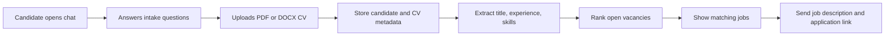

# Recruitment Hub

> **منصة توظيف ذكية ثنائية اللغة** لإدارة الوظائف والمرشحين، مع تجربة تسجيل مرشح تحاكي محادثة واتساب.

Recruitment Hub is an MVP for recruitment consultancies that need a single workspace to manage vacancies, capture candidate information, store CV metadata, surface suitable job opportunities, and track each candidate’s progress. The platform supports both **Arabic (RTL)** and **English (LTR)** interfaces.

## What the MVP includes

| Area | Delivered capability |
| --- | --- |
| Administrative workspace | Dashboard for vacancies, candidates, matching activity, and operational status. |
| Job management | Create, edit, delete, search, close, and export vacancy records. |
| Candidate management | Review profile data, CV extraction status, candidate status, and ranked matches. |
| Candidate intake | WhatsApp-style conversation that collects name, preferred location, salaries, experience, notice period, desired title, and CV. |
| CV handling | PDF and DOCX CV upload, stored as file metadata linked to each candidate. |
| Intelligent extraction | Structured extraction of role, experience, and skills from the uploaded CV. |
| Matching | Deterministic ranking based on job title, location, salary, experience, notice period, and relevant skills. |
| Notifications | Owner alert and notification log when a candidate registers with a CV. |
| Exports | Arabic or English CSV exports for candidates and jobs. |

## Candidate workflow



The conversational experience is designed as a working prototype of the eventual WhatsApp flow. Once a candidate completes the intake, the platform stores the profile, starts CV extraction, records the administrator notification, and returns the best matching open jobs.

## Technology architecture

| Layer | Technology |
| --- | --- |
| Frontend | React 19, TypeScript, Tailwind CSS 4, shadcn/ui, Wouter |
| Backend | Express 4, tRPC 11, Zod validation |
| Database | MySQL-compatible database with Drizzle ORM |
| File storage | S3-compatible storage through the project storage helper |
| CV processing | PDF/DOCX text extraction with structured language-model output |
| Authentication | Manus OAuth with role-aware administrative procedures |
| Testing | Vitest for matching, input validation, authentication, and candidate-intake workflows |

## Project structure

```text
client/
  src/pages/          Dashboard, vacancies, candidates, details, candidate chat
  src/components/     Shared layout, language switch, status and interface components
  src/contexts/       Arabic/English language and direction handling
server/
  routers.ts          Type-safe tRPC procedures
  db.ts               Database helpers
  cvExtraction.ts     CV text extraction and structured profile extraction
drizzle/
  schema.ts           Database schema and migrations
shared/
  matching.ts         Deterministic candidate-to-job matching logic
```

## Local development

### Prerequisites

Use Node.js 22 or later and pnpm. A database connection and the platform-provided environment variables are required for end-to-end operation. Do not commit local `.env` files or credentials.

### Install and run

```bash
pnpm install
pnpm dev
```

The development server runs the React client and Express/tRPC backend together. Open the local preview URL shown by the development command.

### Database workflow

Update `drizzle/schema.ts`, generate a migration, review the generated SQL, and apply it to the target database.

```bash
pnpm drizzle-kit generate
```

For this managed project, apply reviewed SQL through the platform database migration workflow rather than committing connection credentials to the repository.

### Quality checks

```bash
pnpm check
pnpm test
pnpm build
```

## Data model

The core data model uses the following records: `jobs`, `candidates`, `jobMatches`, `candidateSkills`, `cvFiles`, and `notificationLogs`. CV bytes are stored outside the database; the database keeps only file identifiers, URLs, metadata, and related candidate information.

## Current integration boundaries

The MVP implements the candidate conversation **inside the web application**. It is prepared for a future WhatsApp Business API adapter, but it does not yet send or receive messages through a real WhatsApp number. Likewise, the current version manages job data in its own database; Google Sheets and Excel ingestion can be added as a separate connector.

## Recommended next steps

1. Connect Meta WhatsApp Cloud API or another approved WhatsApp Business provider, then implement webhook verification and outbound template-message support.
2. Add a Google Sheets or Excel import/synchronisation workflow for vacancy data.
3. Add advisor roles, assignment queues, interview stages, and audit reporting for recruitment teams.

## Privacy and security

Candidate CVs and employment information are personal data. Restrict administrative access to authorised staff, use storage URLs only through approved server-side flows, and establish retention and deletion rules before production use.

## Repository status

This repository is private and contains the current MVP source code. The application has Arabic/English interface support, responsive administrative views, and automated coverage for its core workflows.
